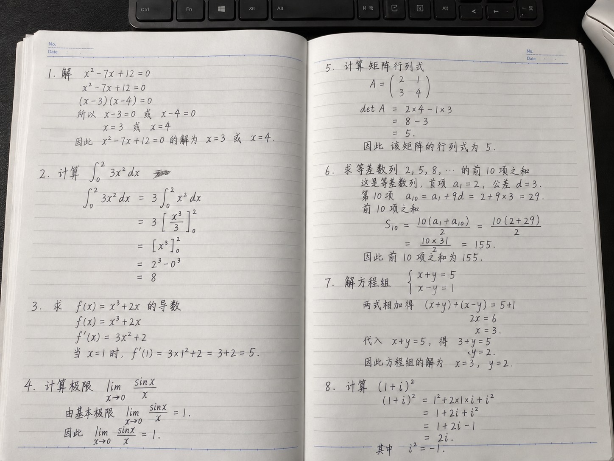

# Handwritten Solution Skill

根据字迹照片和笔记本背景，生成手写风格的题目解答图片。

## 效果示例

上图使用新编的数学例题，展示双页排版和手写效果；实际生成的题目与字迹可根据用户提供的素材调整。

## 使用方法

在支持 Skills 和图片生成的环境中安装本 Skill，然后提供题目、字迹照片和背景模板。生成前确认每一页的题目分布；生成后检查公式、数字和文字。

`SKILL.md` 包含完整流程，`assets/` 中提供仓库作者的参考照片。使用时可提供自己的素材。

生成后，可以选择使用全能扫描王对图片进行扫描风格处理，使成品更接近扫描件。

图片生成可能出现公式或文字错误，应对照原题和解题过程核对。
